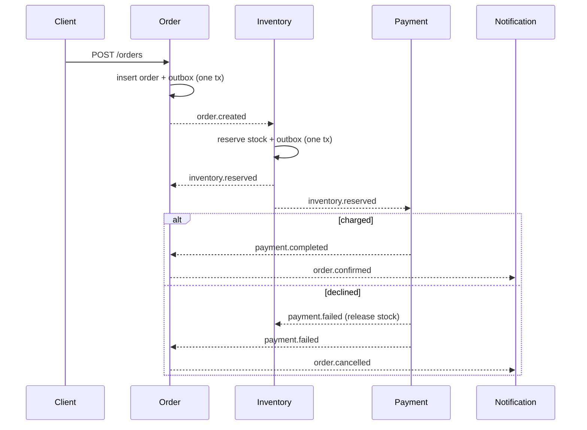

# Event-Driven Order Platform

Four Node.js services (order, inventory, payment, notification) coordinated by a choreographed saga over Kafka (Redpanda), with one PostgreSQL database per service. The project focuses on correctness under failure: no lost events, no duplicate effects, and compensation when a payment fails.

**Stack:** Node.js, Express, KafkaJS, Redpanda, PostgreSQL 16, Docker Compose, OpenTelemetry, Jaeger, Jest, Artillery

## Flow



## Design

- **Transactional outbox.** A service writes its state change and the outgoing event in one database transaction. A relay publishes unpublished rows in batches and marks them published, so a crash between commit and publish cannot lose an event.
- **Idempotent consumers.** Every consumer records the event id in `processed_events` inside the same transaction as its handler. A redelivered event is a no-op.
- **Guarded state transitions.** The order service applies an event only from allowed states. `payment.completed` and `payment.failed` are accepted from `PENDING` or `RESERVED`, because Kafka does not order events across topics and a payment event can arrive before `inventory.reserved`.
- **Compensation.** `payment.failed` releases the reserved stock and cancels the order.
- **Tracing.** OpenTelemetry trace context travels in the event payload (`_tp`), so one order produces one trace across all four services.

## Guarantees and how they are tested

| Guarantee | Mechanism | Evidence |
|---|---|---|
| No lost events | Outbox + polling relay | Crash-recovery test |
| No duplicate effects | `processed_events` per consumer | Same event replayed 5x has one effect |
| Compensation | `payment.failed` releases stock | Payment-failure test; 1,564 compensations under load |
| No double charge | One payment per order + idempotent consumer | `n = distinct_orders` after every load run |
| No stock drift | Reserve and release are guarded updates | Per-SKU stock + reservations = initial stock after every load run |

## Run it

```bash
npm install
docker compose up -d        # wait ~15s for Postgres, Redpanda and Jaeger
```

Start each service in its own terminal:

```bash
npm run inventory
npm run order
npm run payment             # optional: set FAIL_RATE=0.2 to inject payment failures
npm run notification
```

Place an order:

```bash
curl -X POST http://localhost:3001/orders -H "Content-Type: application/json" -d '{"sku":"SKU-1","qty":1}'
```

Run the tests (leave `FAIL_RATE` unset, the replay test assumes payments succeed):

```bash
npm test
```

Traces are at http://localhost:16686 (service `order-service`).

### Test output

```
<paste the npm test output here once it shows 5 passed, 5 total>
```

## Failure trace

An order with `qty: 99` cannot be paid, so it exercises the full compensation path. One trace, 4 services, 7 spans, 354 ms.


The last span, `order-service consume inventory.reserved`, finishes after `payment.failed` has already cancelled the order. The guarded transitions make that late event a no-op. This is the cross-topic ordering race described above.

## Load test results

Environment: a single Windows laptop running Artillery, Docker, Redpanda, four Postgres containers, Jaeger and the four services at the same time. Orders spread randomly across 20 SKUs with 1,000,000 units each. Payment failure rate 20%. Each run started from a wiped database. Reports are in `load/`.

| Arrival rate | Orders | API p95 | API p99 | Failed requests | Confirmed / Cancelled | Drain after load | Duplicate charges | Stock drift |
|---|---|---|---|---|---|---|---|---|
| 30/s for 60 s | 1,800 | 211 ms | 376 ms | 0 | 1,442 / 358 | not measured | 0 | 0 |
| 100/s for 60 s | 6,000 | 1,064 ms | 1,300 ms | 0 | 4,794 / 1,206 | ~116 s | 0 | 0 |

How to read this:

- API latency measures only how fast `POST /orders` accepts an order, not how long the saga takes.
- At 30/s the system kept up. At 100/s the API accepted every order, but the saga fell behind: 5,684 of 6,000 orders were still open when load ended and took about 116 s more to finish. This is overload, not sustained 100 orders/s.
- Correctness held in both runs: every order reached `CONFIRMED` or `CANCELLED`, every payment `n` equals `distinct_orders`, reservations equal the confirmed count, and every SKU total is 1,000,000.
- During the 100/s drain the open-order count froze for about 10 s and 15 s at two points. I suspect consumer group rebalances or paused consumers but have not confirmed it.

Verification queries used after each run:

```sql
-- orders db
select status, count(*) from orders group by status;
-- payments db
select status, count(*) n, count(distinct order_id) distinct_orders from payments group by status;
-- inventory db
select count(*) reservations from reservations;
select count(*) bad from (
  select sku, stock + coalesce((select sum(qty) from reservations r where r.sku = i.sku), 0) total
  from inventory i where sku like 'LOAD-%') t where total <> 1000000;
```

## Known limitations

- Choreography only: there is no saga timeout, so an order can sit in `RESERVED` if the payment service never answers.
- Handler exceptions are retried by the consumer with no dead-letter queue.
- Trace context rides in the event payload, not in Kafka headers.
- The crash-recovery test simulates the post-crash state (committed but unpublished outbox row); it does not kill a real process.
- The throughput ceiling is not diagnosed. Candidates: single-partition topics, the default 10-connection Postgres pools, one Node event loop per service, and the load generator sharing the machine.
- Numbers come from one laptop and are not production figures.

## What I would change at 100x scale

- Partition every topic by `orderId` and run several consumers per group (today: one partition per topic).
- Replace the polling relay with CDC (Debezium) on the outbox table and archive published rows.
- Remove the hot inventory row by sharding stock per SKU into buckets or pre-decrementing in batches.
- Add a saga timeout sweeper, a DLQ with retry and backoff, and a real payment provider with idempotency keys.
- Add a schema registry and event versioning, plus Prometheus metrics with consumer-lag alerts.
- Move to managed Kafka (MSK) and one RDS instance per service, with the services on ECS or Kubernetes with autoscaling.